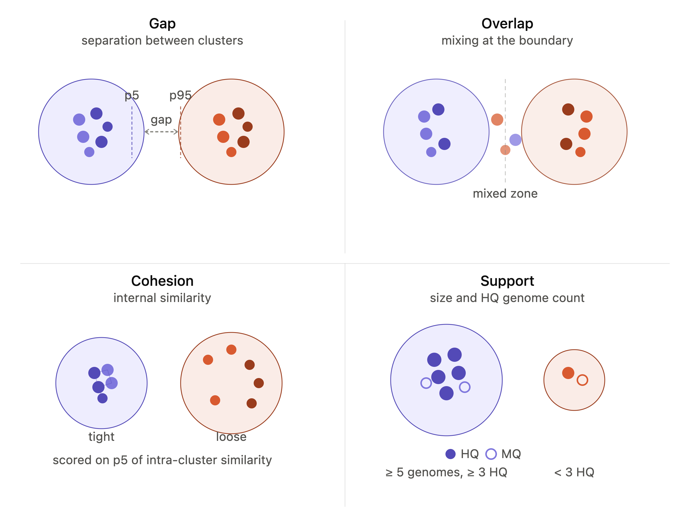
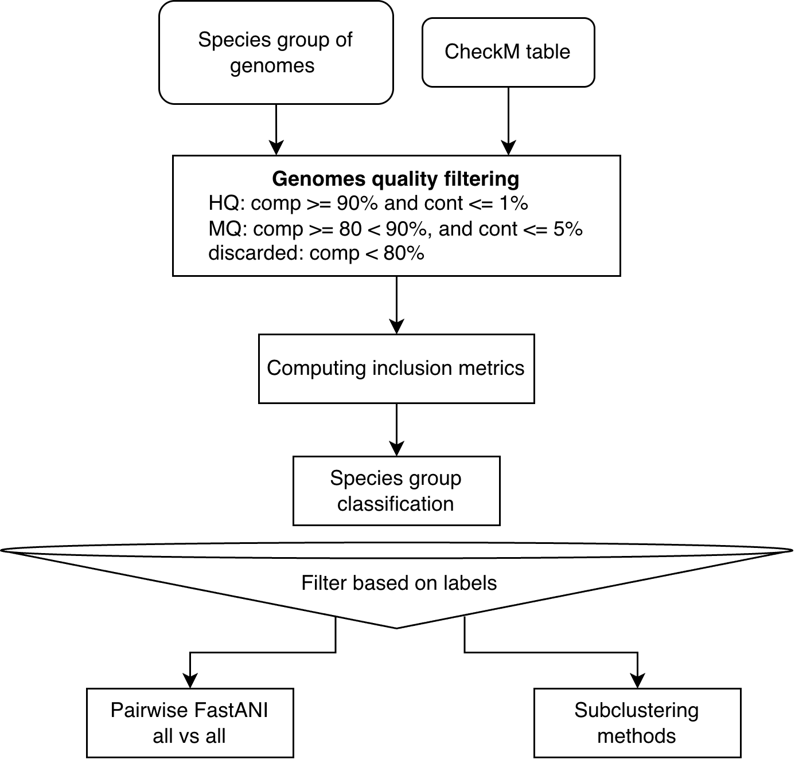
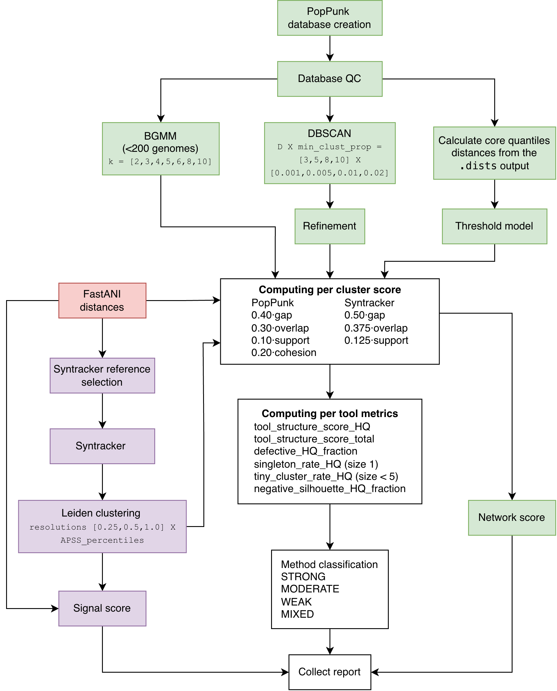

# Subspecies Profiler Pipeline (SPP)

<p align="center" width="100%">
   
</p>

## Introduction

**ebi-metagenomics/subspeciesprofiler** is a bioinformatics pipeline that generates subspecies clusters from a group of genomes of the same species.

Given, per species, a directory of assembled genomes and a per-genome completeness/contamination table, for each eligible species the pipeline:

1. **Classifies** each genome as HQ / MQ / DISCARDED from its completeness/contamination and contiguity (N50, or N90, of at least 5 kb) and decides whether the species group is eligible for subspecies clustering (`speciesqc`).
2. Builds and QCs a **[PopPUNK](https://poppunk.bacpop.org)** database from the HQ/MQ genomes and derives a **core-distance threshold sweep** from the observed distance distribution.
3. Fits PopPUNK clustering models and **scores each against all-vs-all [FastANI](https://github.com/ParBLiSS/FastANI)**, then selects the model(s) that best recover the ANI-defined subspecies structure.
4. Independently, clusters the species by **synteny** with [SynTracker](https://github.com/leylabmpi/SynTracker), run on the same HQ and MQ genomes against the most central HQ genome, clustered into Leiden communities of the synteny (APSS) graph, and scores those clusterings in synteny space with an ANI-concordance check, in a separate SynTracker model report.
5. Builds the species' **pangenome** from the same genomes: gene calls with [ggCaller](https://github.com/bacpop/ggCaller), clustered by [Panaroo](https://github.com/gtonkinhill/panaroo) into a gene presence/absence table (`gene_presence_absence.Rtab`).

Outputs are a per-species set of PopPUNK databases, fitted models (with diagnostic plots), ANI-based scores, and a [MultiQC](http://multiqc.info/) report.

### Quality control workflow

<p align="center" width="100%">
   
</p>

### Clustering methods

<p align="center" width="100%">
   
</p>

## Usage

> [!NOTE]
> If you are new to Nextflow and nf-core, please refer to [this page](https://nf-co.re/docs/usage/installation) on how to set-up Nextflow. Make sure to [test your setup](https://nf-co.re/docs/usage/introduction#how-to-run-a-pipeline) with `-profile test` before running the workflow on actual data.

Prepare a samplesheet describing the species to cluster — one row per species:

`samplesheet.csv`:

```csv
species,genomes_dir,qc_csv
bacteroides_xylanisolvens,/path/to/bxylanisolvens/genomes,/path/to/bxylanisolvens/qc.csv
```

| Column        | Description                                                                                                 |
| ------------- | ----------------------------------------------------------------------------------------------------------- |
| `species`     | Unique species name (no spaces).                                                                            |
| `genomes_dir` | Directory of assembled genomes for that species. FASTA (`.fasta`/`.fa`/`.fna`), optionally gzipped (`.gz`). |
| `qc_csv`      | Per-genome completeness/contamination table for that species (see below).                                   |

The `qc_csv` has a header row and one row per genome. The `genome` column is the **assembly filename with its extension** (it is stripped to the PopPUNK sample name), and the completeness/contamination columns are matched case-insensitively by name (so CheckM/CheckM2-style headers work directly):

```csv
genome,completeness,contamination
MGYG000001345.fasta,99.5,0.5
MGYG000005313.fasta,98.2,1.1
```

Now, you can run the pipeline using:

```bash
nextflow run ebi-metagenomics/subspeciesprofiler \
   -profile <docker/singularity/.../institute> \
   --input samplesheet.csv \
   --outdir <OUTDIR>
```

> [!NOTE]
> On x86_64 Linux clusters, use `-profile singularity` (or `docker`); no special settings are needed. The PopPUNK, FastANI and pandas steps all ship pinned containers.

> [!WARNING]
> Please provide pipeline parameters via the CLI or Nextflow `-params-file` option. Custom config files including those provided by the `-c` Nextflow option can be used to provide any configuration _**except for parameters**_; see [docs](https://nf-co.re/docs/usage/getting_started/configuration#custom-configuration-files).

For more details and further functionality, please refer to the [usage documentation](https://github.com/ebi-metagenomics/subspeciesprofiler/blob/master/docs/usage.md) and the [parameter documentation](https://github.com/ebi-metagenomics/subspeciesprofiler/blob/master/nextflow_schema.json).

## How it works

### Genome classification and species eligibility

Each genome is classified from its completeness (`comp`) and contamination (`cont`):

| Class         | Rule                                     |
| ------------- | ---------------------------------------- |
| **HQ**        | `comp ≥ 90` and `cont ≤ 1%`              |
| **MQ**        | `comp ≥ 80` and `cont ≤ 5%`              |
| **DISCARDED** | otherwise (dropped; not sent to PopPUNK) |

An HQ or MQ genome is also DISCARDED if its N50 (or N90, with `--qc_strict_contiguity`) is below `--qc_min_nx` (default 5000 bp, the SynTracker window length), from [SeqKit](https://bioinf.shenwei.me/seqkit/) stats. Each species is then given an eligibility label from its HQ / effective-genome counts, after both filters (`STRONG`, `ACCEPTABLE`, `NOT_ELIGIBLE`, `DISCARDED`, with `_BOUNDARY` / `_NEAR_THRESHOLD` variants). Only species whose label is in `--qc_filter` (default `STRONG,STRONG_BOUNDARY,ACCEPTABLE,ACCEPTABLE_BOUNDARY`) proceed.

FastANI then compares the remaining genomes. The ANI QC step discards the fewest genomes needed so that every remaining pair has a FastANI value of at least 90%. The label is computed again and `--qc_filter` is applied again. Every branch (PopPUNK, SynTracker, pangenome, ANI plot and tree) uses this final genome list.

### Model scoring and selection

Candidate PopPUNK models are scored against all-vs-all FastANI:

- **Within-species ANI gate** — every genome pair in a species group must be ≥ `--min-ani` (0–1 scale, default `0.90`) similar. The ANI QC step removes genomes behind a pair below the threshold or a pair with no FastANI value, so this gate is a safety check.
- **`tool_status`** ∈ `Strong` / `Moderate` / `Weak` / `Mixed` — the clustering quality, weighted towards the trustworthy HQ genomes (cluster cohesion + separation, penalising over-splitting).
- **`decision`** ∈ `ACCEPT` / `TRY_NEXT_MODEL` — `ACCEPT` when `tool_status` is in `--accept-status` (default `Strong`).

**All accepted models are reported** (e.g. several `Strong` fits from one sweep), together with the single best-ranked model as a fallback.

## Pipeline output

Results are organised per species under `<outdir>/`:

| Path                                  | Contents                                                                                                                                                                       |
| ------------------------------------- | ------------------------------------------------------------------------------------------------------------------------------------------------------------------------------ |
| `speciesqc/<species>/`                | Eligibility report, per-genome QC table (`*_genome_qc.tsv`) and seqkit stats, the PopPUNK r-file and per-genome HQ/MQ labels.                                                  |
| `<species>/<species>_ani_overview.*`  | Per-species figure (PNG + PDF): pairwise ANI histogram with a density curve, and the ANI heatmap ordered by UPGMA clustering with dendrograms and an HQ/MQ strip.              |
| `poppunk/<species>/createdb/`         | The PopPUNK sketch database + core/accessory distances (with diagnostic plots).                                                                                                |
| `poppunk/<species>/qcdb/`             | The QC'd (pruned) database (with plots).                                                                                                                                       |
| `poppunk/<species>/quantiles/`        | The data-derived core-distance thresholds (`*_core_quantiles.csv`).                                                                                                            |
| `<species>/fastani/`                  | The all-vs-all ANI (`*.ani.txt`), shared by every branch.                                                                                                                      |
| `<species>/<species>_ani_nj_tree.nwk` | Neighbour-joining tree (Newick) of the ANI distances (1 − ANI/100).                                                                                                            |
| `poppunk/<species>/fitmodel/<model>/` | Each fitted PopPUNK model — cluster assignments (`*_clusters.csv`) and fit plots — one dir per model.                                                                          |
| `poppunk/<species>/evaluate/<model>/` | The per-model verdict: `*.tool_metrics.tsv` (`model`, `poppunk_network_score`, `tool_status`, scores, `decision`, `eval_summary`) plus per-cluster and per-genome metrics.     |
| `<species>/syntracker/`               | SynTracker branch: reference/target selection, APSS tables, one `Taxon,Cluster` table per APSS floor × resolution, their APSS/ANI evaluations and the SynTracker model report. |
| `<species>/pangenome/`                | ggCaller gene calls (proteins, CDSs, GFFs) and the Panaroo pangenome, including `gene_presence_absence.Rtab`.                                                                  |

For more details about the output files and reports, please refer to the
[output documentation](https://github.com/ebi-metagenomics/subspeciesprofiler/blob/master/docs/output.md).
For how to read the per-species model report and choose a model (or conclude a species has
no subspecies structure), see the
[curation guide](https://github.com/ebi-metagenomics/subspeciesprofiler/blob/master/docs/curation.md).

## After the pipeline: ordination and gene enrichment

`bin/ordination_enrichment.py` compares the gene content of the clusters of one fit. You run it yourself after the pipeline; the pipeline does not run it. It makes a PCoA ordination of the Panaroo gene presence/absence matrix (Jaccard distance), pairwise ANOSIM tests between clusters, a Fisher gene-enrichment table and iTOL annotation files for the ANI tree. With a metadata table, it also colours the ordination and the tree by categories such as disease status.

### Run it in the pipeline's container

You do not need to install anything. The PopPUNK image of the pipeline has every package that the script needs (numpy, pandas, scipy and matplotlib). If you ran the pipeline with PopPUNK, the image is already on your system.

With Singularity (for example on an HPC cluster):

```bash
singularity exec https://depot.galaxyproject.org/singularity/poppunk:2.7.8--py310h4d0eb5b_0 \
    python subspeciesprofiler/bin/ordination_enrichment.py [options]
```

To use the image that Nextflow already downloaded, find it with `ls "$NXF_SINGULARITY_CACHEDIR" | grep poppunk`, and give its path to `singularity exec` in place of the URL. Singularity mounts the current directory and your home directory.

With Docker:

```bash
docker run --rm --platform linux/amd64 -v "$PWD":"$PWD" -w "$PWD" \
    quay.io/biocontainers/poppunk:2.7.8--py310h4d0eb5b_0 \
    python subspeciesprofiler/bin/ordination_enrichment.py [options]
```

The image is for linux/amd64 only. On Apple Silicon, Docker runs it under emulation, which is enough for this script. Without containers, install the packages with `pip install numpy pandas scipy matplotlib`.

### Inputs

| Option               | Content                                                                                                                                                                                                                                                           |
| -------------------- | ----------------------------------------------------------------------------------------------------------------------------------------------------------------------------------------------------------------------------------------------------------------- |
| `--rtab`             | `<species>/pangenome/panaroo/gene_presence_absence.Rtab`.                                                                                                                                                                                                         |
| `--clusters`         | The `Taxon,Cluster` CSV of the fit you chose. For a PopPUNK fit: `<species>/poppunk/fitmodel/<model>/<species>_fitmodel/<species>_fitmodel_clusters.csv`. For a SynTracker clustering: `<species>/syntracker/clusters/<species>_syntracker_<model>_clusters.csv`. |
| `--annotations`      | A table with the gene ID in column 1 and its annotation in column 2. Make it from Panaroo's `gene_presence_absence.csv` (see the example below).                                                                                                                  |
| `--tree`             | Optional. `<species>/<species>_ani_nj_tree.nwk`. The script checks the iTOL node names against the tree leaves and reports mismatches.                                                                                                                            |
| `--metadata`         | Optional. A table with the genome ID in column 1 and one category variable in each other column (see below).                                                                                                                                                      |
| `--enrich-cluster`   | Optional. A cluster to compare with all other genomes. Without it, the script compares the two largest clusters.                                                                                                                                                  |
| `--min-cluster-size` | The smallest cluster for an enrichment test (default 5).                                                                                                                                                                                                          |
| `--outdir`           | The output directory (default `.`).                                                                                                                                                                                                                               |
| `--prefix`           | The prefix of the output files (default `pangenome`).                                                                                                                                                                                                             |

A metadata table has a header row, and the genome IDs must be the same as in the Rtab:

```tsv
genome	disease_status	genome_type	genome_source
GCA_000001.1	CRC	isolate	clinical
MGYG000002	control	MAG	gut
MGYG000003	unknown	MAG	oral
```

A genome that is not in the table, or an empty cell, gets the category `NA`. `NA` and `unknown` are light grey.

### Outputs

| File                                     | Content                                                                                                         |
| ---------------------------------------- | --------------------------------------------------------------------------------------------------------------- |
| `<prefix>_ordination.{png,pdf}`          | PCoA coloured by cluster, with a 90% ellipse per cluster. Singletons are hollow.                                |
| `<prefix>_ordination_coords.csv`         | The PCoA coordinates, cluster and metadata of each genome.                                                      |
| `<prefix>_anosim.csv`                    | Pairwise ANOSIM between clusters of at least 3 genomes: R statistic, p-value and Benjamini-Hochberg FDR.        |
| `<prefix>_enrichment.csv`                | Fisher's exact test per gene: odds ratio, p-value, FDR and direction, or a note that the test was not possible. |
| `<prefix>_itol_colors.txt`               | iTOL file that colours each genome of the tree in its cluster colour.                                           |
| `<prefix>_ordination_<column>.{png,pdf}` | With `--metadata`: one PCoA per metadata column, coloured by category, with the cluster ellipses in grey.       |
| `<prefix>_itol_<column>.txt`             | With `--metadata`: one iTOL file per metadata column, drawn as an outer ring of coloured categories.            |

To see the annotations on the tree, upload `<species>_ani_nj_tree.nwk` to [iTOL](https://itol.embl.de/). Then drag `<prefix>_itol_colors.txt` and each `<prefix>_itol_<column>.txt` file onto the tree. iTOL adds the rings from the inside out, in the order that you add the files.

### Examples

Make the annotation table from Panaroo's output, inside the container. Panaroo's first and third columns are `Gene` and `Annotation`:

```bash
python -c "import pandas as pd; pd.read_csv('gene_presence_absence.csv', usecols=[0, 2]).to_csv('annotations.csv', index=False)"
```

A basic run, which compares the two largest clusters:

```bash
python bin/ordination_enrichment.py \
    --rtab gene_presence_absence.Rtab \
    --clusters dbscan_D3_mcp0.001_clusters.csv \
    --annotations annotations.csv \
    --outdir ordination --prefix b_fragilis
```

A run with the tree and the metadata, which also writes the metadata plots and the iTOL rings:

```bash
python bin/ordination_enrichment.py \
    --rtab gene_presence_absence.Rtab \
    --clusters dbscan_D3_mcp0.001_clusters.csv \
    --annotations annotations.csv \
    --tree bacteroides_fragilis_ani_nj_tree.nwk \
    --metadata metadata.tsv \
    --outdir ordination --prefix b_fragilis
```

## Credits

ebi-metagenomics/subspeciesprofiler was originally written by Alejandra Escobar.

## Contributions and Support

If you would like to contribute to this pipeline, please see the [contributing guidelines](.github/CONTRIBUTING.md).

## Citations

An extensive list of references for the tools used by the pipeline can be found in the [`CITATIONS.md`](CITATIONS.md) file.
